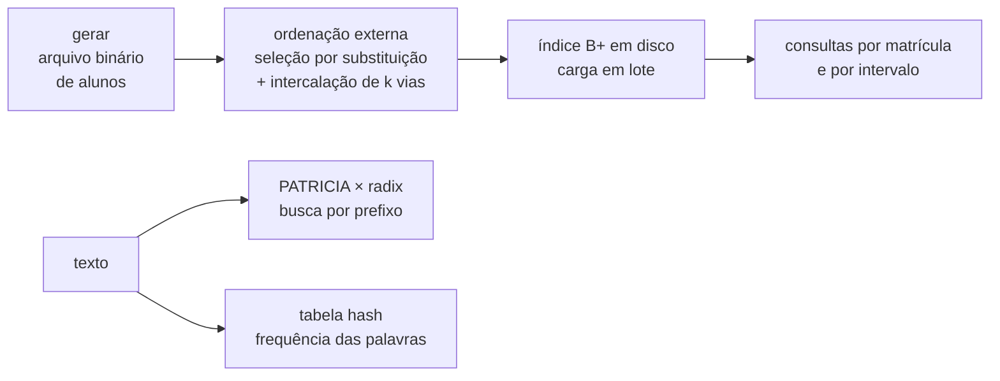

# Estruturas de dados em C: árvore B+ em disco, PATRICIA, radix, hash e ordenação externa

Biblioteca e programa de linha de comando em C11 com as estruturas de busca e armazenamento estudadas em Estruturas de Dados II. Elas funcionam juntas num fluxo de "banco de dados" de alunos:



```text
$ ed consultar alunos_ordenados.bin alunos.idx 400000
  400000  Sofia Esteves            notas  5.6  0.1  4.1  média  3.3  (registro 100000)
  custo: 3 páginas do índice (= altura) + 1 leitura no arquivo de dados

$ ed faixa alunos_ordenados.bin alunos.idx 300000 300300
  300001  Natália Quintana         notas  5.9  7.7  7.8  média  7.1  (registro 66667)
  ...
100 alunos com matrícula entre 300000 e 300300; média geral 5.20
  páginas do índice lidas: 4 (desce uma vez e segue a lista de folhas)
```

## O que foi corrigido em relação às versões originais

| Original | Problema | Agora |
|---|---|---|
| Árvore B+ (`ArvoreB+`) | Não compilava: `chaves[]` sem índice, variável `no` inexistente, funções sem protótipo. Não tinha inserção. A remoção parava no meio. | B+ completa em disco: inserção com divisão, remoção com empréstimo e fusão, intervalo, carga em lote, verificador de invariantes. |
| `ArvB+_QuickSort_Interno.c` | Na verdade é uma árvore **B** (as chaves sobem e não ficam nas folhas, e não há lista de folhas). O `split` decrementava o número de chaves do pai. | A B+ acima. |
| `ArvB+_QuickSort_Externo.c` | Chamava de "ordenação externa" um quicksort em memória dentro de um nó. | Ordenação externa de verdade: corridas por quicksort ou por seleção por substituição, depois intercalação de k vias. |
| "Árvore Patrícia" | Era uma árvore de prefixos por caractere (radix), não a PATRICIA de Morrison. Bugs: retorno de `realloc` descartado; `strcpy` com origem e destino sobrepostos (comportamento indefinido); inserção recursiva com resultado perdido; remoção sem refundir nós; nenhum `free`; `printf` de depuração. | **Radix corrigida**, com a mesma ideia de lista de irmãos ordenada, **e a PATRICIA de verdade**, por bits. |
| Tabela hash | A inserção "sem colisão" sobrescrevia a posição e vazava memória. Sem remoção e sem checagem de duplicata. Overflow de `int` com sinal no hash de strings (comportamento indefinido). A "dobra" usava `TABLE_SIZE − 1` como máscara sem potência de 2. | Encadeamento, sondagem linear, quadrática e hash duplo, com lápides, redimensionamento e medição de sondagens comparada à teoria. |

## As estruturas

### Árvore B+ em disco ([bplus.h](include/ed/bplus.h))

- **Páginas no arquivo:**
  - cada nó é uma página de 4 KiB;
  - a página 0 é o cabeçalho (raiz, altura, contagens, lista de páginas livres);
  - páginas liberadas por fusões são reutilizadas;
  - tudo é gravado em little-endian explícito, sem depender de `fwrite` de structs.
- **Ordem configurável de 3 a 340** (máximo de chaves por nó). Ocupação mínima: folhas ⌊(m+1)/2⌋ e internos ⌊m/2⌋, o que garante que uma fusão sempre cabe num nó.
- **Divisão de nós:** na folha, a primeira chave da direita **sobe e continua na folha**. No nó interno, a chave do meio sobe e sai do nó. A árvore cresce pela raiz, então todas as folhas ficam na mesma profundidade.
- **Remoção:** pede emprestado ao irmão esquerdo ou direito. Se nenhum pode emprestar, funde os dois nós e libera a página. A raiz encolhe quando fica sem chaves.
- **Lista duplamente ligada de folhas:** uma consulta por intervalo desce uma vez e depois só lê folhas em sequência.
- **Carga em lote (bulk loading):** monta a árvore de baixo para cima a partir de um arquivo ordenado, com preenchimento configurável e sem nenhuma divisão de nó.
- **Verificador:**
  - ordem e limites dos separadores;
  - ocupação mínima e folhas na mesma altura;
  - a lista de folhas coincide com a árvore e os ponteiros "anterior" estão coerentes;
  - nenhuma página perdida: cabeçalho + nós + livres = total.
- **Contadores de E/S:** uma busca numa árvore de altura 3 lê exatamente 3 páginas (há teste disso).

### PATRICIA ([patricia.h](include/ed/patricia.h))

A formulação de Knuth/Ziviani:

- **Nós:** os nós internos guardam só o **índice do bit** que decide o caminho; as folhas guardam as chaves.
- **Tamanho fixo:** com n chaves há exatamente n folhas e n − 1 nós internos, qualquer que seja o comprimento das chaves.
- **Busca:** os índices crescem do topo para baixo, a busca testa no máximo um bit por nível e compara a chave inteira uma única vez, na folha.
- **Prefixos e ordem:** as chaves são lidas como bits seguidos de `\0`, então "bola" e "bolacha" convivem, e o percurso sai em ordem lexicográfica de bytes (UTF-8 incluído).
- **Busca por prefixo:** desce enquanto o bit testado está dentro do prefixo e confere uma única folha.

### Radix ([radix.h](include/ed/radix.h))

A estrutura do trabalho original, corrigida:

- cada aresta carrega um pedaço da palavra, e os filhos ficam numa lista ordenada pelo primeiro byte;
- a inserção divide rótulos;
- a remoção apaga nós inúteis e **refunde** nós que ficaram com um filho só.

```text
$ ed palavras dados/texto-exemplo.txt bo
668 palavras, 313 distintas
  estrutura                                nós     altura     memória
  PATRICIA (bits)                           625         19      22288 B
  radix (prefixos por caractere)            422          8      15159 B
  com prefixo "bo" (PATRICIA): bo, boa, bola, bolacha, bolo, bonita   (a radix encontrou 6: igual)
```

### Tabela hash ([hash.h](include/ed/hash.h))

- **Chaves e capacidade:** chaves texto → `int64`, com FNV-1a de 64 bits + mistura final. A capacidade é potência de 2: com um hash bem misturado isso não prejudica a distribuição, e garante que a sondagem **quadrática por números triangulares** e o **hash duplo com passo ímpar** visitam todas as posições.
- **Remoção no endereçamento aberto:** usa lápides (apagar a posição quebraria a sondagem de outras chaves). Elas contam na carga e somem no redimensionamento.
- **Experimento:** `hash-experimento` mede as sondagens e compara com as fórmulas de Knuth (TAOCP vol. 3, §6.4):

```text
  estratégia          α          com sucesso          sem sucesso  maior cadeia
  linear           0.75      2.45 / 2.50          8.38 / 8.50                84
                   0.90      5.18 / 5.50         46.77 / 50.50              518
  hash duplo       0.75      1.84 / 1.85          3.98 / 4.00                25
                   0.90      2.55 / 2.56          9.96 / 10.00               66
```

### Ordenação externa ([ordenacao_externa.h](include/ed/ordenacao_externa.h))

- **Arquivo:** binário de registros de 56 bytes, ordenado usando só M registros na memória.
- **Geração das corridas:** quicksort (mediana de três, inserção nos pequenos, pilha O(log n)) gera corridas de exatamente M registros. A **seleção por substituição** gera corridas de ≈ 2M em entrada aleatória.
- **Intercalação:** de k vias com heap mínimo, em ⌈log_k(corridas)⌉ passadas.

```text
$ ed ordenar alunos.bin alunos_ordenados.bin --memoria 10000 --metodo selecao --vias 8
200000 registros ordenados em 0.45 s com 10000 registros na memória (seleção por substituição, 8 vias)
  corridas iniciais: 11 (tamanho médio 18182 = 1.82 × memória)
  passadas de intercalação: 2 (⌈log_8 11⌉)
```

## Como compilar e executar

Requer um compilador C11 (GCC ou Clang) e `make`.

```bash
make                 # biblioteca, programa build/ed e testes
make teste           # roda os testes
make sanitizado      # testes com AddressSanitizer + UndefinedBehaviorSanitizer (Linux/macOS)
build/ed demo        # roteiro completo: 200 mil alunos, ordenação, índice, consultas, 150 mil remoções
build/ed palavras dados/texto-exemplo.txt bo
build/ed hash-experimento 16
```

**Code::Blocks:** abra `estruturas-de-dados.cbp`. Há um alvo para o programa e um para cada grupo de testes.

**WebAssembly:** `make wasm ZIG=zig NODE=node` compila o mesmo código para WASI e roda os testes dentro do Node. É útil onde executáveis nativos novos são bloqueados (por exemplo, Windows com Smart App Control).

## Testes e qualidade

- **4 programas de teste com cerca de 488 mil verificações:**
  - operações aleatórias comparadas com uma referência ingênua, com o verificador de invariantes rodando no meio;
  - B+ nas ordens 3, 4, 5, 16 e 340, com reabertura do arquivo, carga em lote em dezenas de combinações de tamanho, ordem e preenchimento, e o custo de E/S;
  - PATRICIA e radix contra um vetor ordenado, com o exemplo original de palavras e as remoções do `main` original;
  - as quatro estratégias de hash, com as sondagens dentro de 12% das fórmulas de Knuth;
  - ordenação externa com várias memórias e números de vias, conferindo o conteúdo registro a registro.
- **Vazamentos:** todo `malloc` passa por um contador ([memoria.h](include/ed/memoria.h)), e cada teste falha se deixar memória sem liberar.
- **Teste de mutação:** bugs introduzidos de propósito, como separador não atualizado, ponteiro de folha esquecido, sondagem com i² ou remoção sem lápide, são todos detectados pelos testes.
- **Compilação:** sem avisos com `-Wall -Wextra -Wpedantic -Wshadow -Wconversion` em GCC e Clang. O analisador estático do GCC (`-fanalyzer`) não acusa nada.
- **CI no GitHub Actions:** GCC e Clang, `-Werror`, testes com AddressSanitizer + UBSan e a demonstração.

## Estrutura

```
include/ed/            # cabeçalhos públicos (bplus, patricia, radix, hash, ordenacao_externa, registro, memoria)
src/                   # implementações
app/ed.c               # programa de linha de comando
tests/                 # testes (teste.h é o mini-framework)
dados/texto-exemplo.txt
ferramentas/executar-wasi.mjs
Makefile, estruturas-de-dados.cbp
```

## Autoria

Carolina Jordão Fonseca — Bacharelado em Ciência da Computação, FCT/UNESP.

Disciplina de Estruturas de Dados II.
